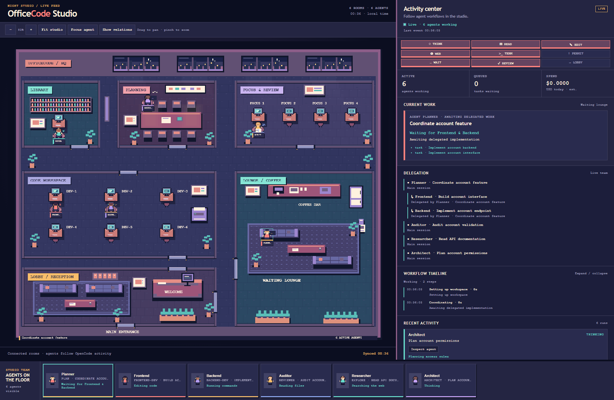

# OfficeCode

A plugin for [OpenCode](https://opencode.ai/) and [Hermes Agent Desktop](https://hermes-agent.nousresearch.com/) that visualizes agents and tool activity in a spacious pixel-art office. Six connected rooms follow their work, with a lobby, library, and lounge for delegation waits. Themes follow your local clock. Your agent app runs every model; the dashboard makes no additional model calls.

Click an agent or computer to inspect its work, concurrent tools, delegation links, and workflow timeline. Select a room to highlight its current occupants. Activity poses/screens show reading, editing, browsing and running tests; completed subagents send a brief result animation to their active parent. Drag the activity divider or use **Hide activity** for a wider desktop studio that fits the screen height; your layout is saved in the browser. Use **Fit studio**, **Focus agent**, drag, or pinch to navigate. Avatar models remain stable per session. **Project dashboard** switches between active OpenCode projects. **Follow agent** tracks movement; **Focus feature** spotlights its delegated team. **Photo mode** exports a clean studio PNG with a temporary theme. Use **Visual settings** for automatic/manual themes, animation level, agent label size, and bubbles. **Attention** opens permission/error/connection details; **Completed tasks** keeps observed workflow summaries after characters leave.



Preview uses sample session events in an isolated workspace.

## Install

Requires Node.js 18+, npm, Git, and your agent app. OpenCode integration tested on Windows with OpenCode 1.18.33.

### OpenCode

```bash
git clone https://github.com/ReBioNC/OfficeCode.git
cd OfficeCode
npm ci
npm run install:opencode
```

The installer builds the dashboard and installs the global plugin and `/dashboard` command. **Keep the OfficeCode folder in place.**

### Install with an OpenCode agent

Open a terminal in `~/.config/opencode/` (Windows: `%USERPROFILE%\.config\opencode\`), run `opencode`, select **Build**, and paste this prompt. If `XDG_CONFIG_HOME` is set, use its `opencode/` folder instead.

```text
Install https://github.com/ReBioNC/OfficeCode.git as a global OpenCode plugin.
Check git, node, npm, and opencode. Clone into a permanent OfficeCode folder
in my home directory, or reuse a verified existing checkout. Read its README
and installer, then run npm ci and npm run install:opencode from the checkout.
Preserve my OpenCode settings, models, other plugins, and local changes.
Verify the installed plugin, checkout root, /dashboard command, and build
files. Report failures clearly, then explain how to restart and open it.
```

### Hermes Agent Desktop

From the same permanent OfficeCode checkout, with the `hermes` CLI in PATH:

```bash
npm ci
npm run install:hermes
```

The installer builds OfficeCode and enables its native observer plugin in your `HERMES_HOME` profile (Desktop default on Windows: `%LOCALAPPDATA%\hermes`; macOS/Linux: `~/.hermes`). It preserves other plugins and model settings. **Quit and reopen Hermes Desktop**, send a task, then run **`/office-dashboard`** and open its URL. The server starts on the first observed task; quitting Desktop's managed local backend stops its connector and lease. No extra models or tools are added. Hermes dashboards group sessions by profile, including foreground/background subagents; **Project dashboard** also lists these active profiles.

## Update

From your existing OfficeCode folder, with a clean working tree:

```bash
git pull --ff-only
npm ci
npm run install:opencode
```

For Hermes, use `npm run install:hermes` instead of `npm run install:opencode`, then quit/reopen Desktop. Keep the checkout in place; hard-refresh the dashboard with `Ctrl+F5`.

Stop if any command fails; resolve local changes or branch divergence before continuing.

### Update with an OpenCode agent

Start OpenCode from the same global configuration folder, select **Build**, and paste:

```text
Update my existing global OfficeCode plugin. Find its checkout from
plugins/office-dashboard.json in OpenCode's global config, checking any
OFFICECODE_ROOT override. Verify the repository, branch, upstream, and
working tree. Ask before resolving local changes or branch divergence.
Keep the checkout path and branch, run git pull --ff-only, read the updated
README and installer, then run npm ci and npm run install:opencode.
Preserve OpenCode settings, models, other plugins, and dashboard data.
Stop on errors. Verify the installed plugin, root, command, and build files;
report the resulting commit and explain how to restart and refresh.
```

For OpenCode, after installing or updating, **close all OpenCode instances**, reopen OpenCode in any project, run `/dashboard`, and open its URL. Hard-refresh an existing browser tab with `Ctrl+F5`.

The server starts automatically with OpenCode and stops after the last OpenCode instance using that project closes. `/dashboard` only shows the URL and status; `npm run dev` is unnecessary.

For troubleshooting, uninstall, API, and development details, see the [full guide](docs/GUIDE.md).

### API additions

| Endpoint | Dashboard metadata |
| --- | --- |
| `GET /api/projects` | Current dashboard plus verified active agent dashboards from local plugin registrations; optional `?verify=<local URL>` rechecks a listed destination before navigation. It never starts a server. |
| `GET /api/health` | `activeLeases` counts connected agent runtimes; `lastEventAt` is the last run update time. |
| `POST /api/mirror/session` | Optional `parentSessionId` links an OpenCode subagent to its parent. |
| `GET /api/runs` | Mirrored runs include `startedAt`, `finishedAt`, and the latest 100 timestamped `timeline` steps. History remains available until the server stops. |
| `POST /api/mirror/event` | Optional `activeTools` lists concurrent calls; `toolResult` records a completed/failed call with duration. |
